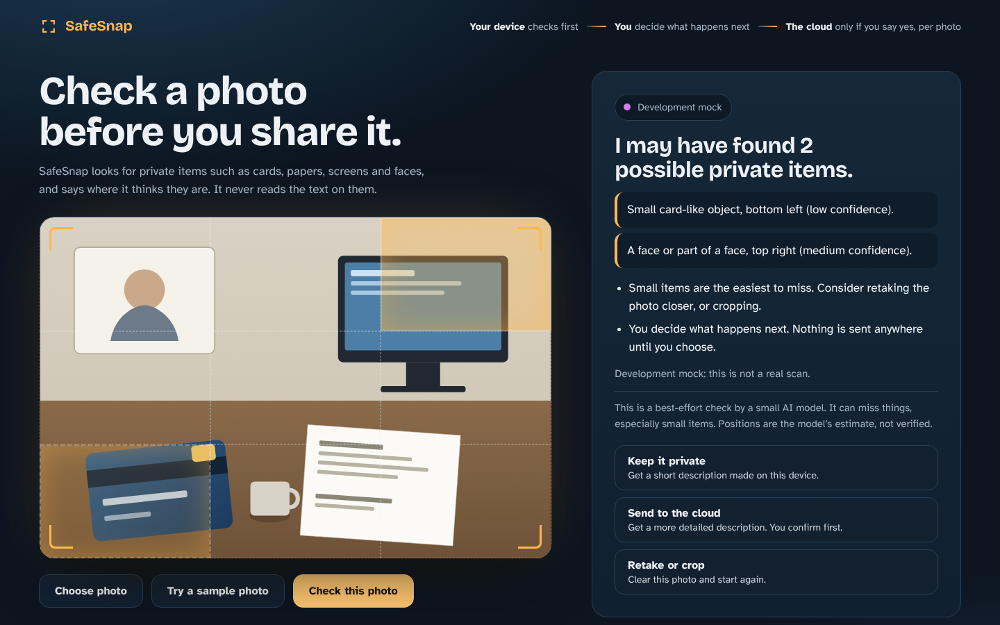

# SafeSnap

**Check a photo before you share it.** SafeSnap is a private checkpoint for photos, designed first for blind and low-vision people, who often cannot see what a photo reveals before they send it.

Built for the #BuildHybridAI hackathon with **Firebase AI Logic** hybrid inference (Gemini Nano on device, Gemini in the cloud).

*The screenshot uses the development mock scanner to show the layout. Real results come from Gemini Nano or the cloud model.*

## The problem

Blind and low-vision people share photos without being able to see what is in the frame: a bank card on the desk, a letter, a screen, a face. Research on assistive photo services found that over 10% of images people submitted contained private content. Cloud tools that describe photos send the whole image away before the person can decide.

## What it does

1. **Your device checks first.** Gemini Nano, running in Chrome, looks for six kinds of possibly private items: faces, card-like objects, documents, screens, address-like text, and other items that may be private. For each one it gives a position on a fixed 3×3 grid, a size and a confidence. It never reads or repeats text.
2. **You decide what happens next:**
   - *Keep it private:* a short description made on the device.
   - *Send to the cloud:* a detailed description from Gemini in the cloud, only after you confirm for that photo.
   - *Retake or crop:* clear the photo and try again.
3. **It says which engine ran**, every time.

## Honesty rules (hard-coded)

- It never says a photo is "safe". The best it says is "I didn't find anything private, but I can't be certain."
- Positions are labelled as the model's estimate.
- If the on-device model is missing, it tells you and offers a consent-based cloud check. It never silently uses the cloud.
- SafeSnap itself stores nothing. Photos are processed in the browser tab.
- It reports what it measured. See *Evaluation*.

## How Firebase AI Logic is used

| What | File |
| --- | --- |
| Hybrid setup, App Check | [`src/firebase/client.ts`](src/firebase/client.ts) |
| On-device scan (`ONLY_ON_DEVICE`) and cloud scan (`ONLY_IN_CLOUD`), `inferenceSource` | [`src/scanner/firebaseScanner.ts`](src/scanner/firebaseScanner.ts) |
| Shared structured-output schema | [`src/scanner/schema.ts`](src/scanner/schema.ts) |
| Short on-device and detailed cloud descriptions | [`src/describe/describe.ts`](src/describe/describe.ts) |
| Never-"safe" report builder | [`src/report/report.ts`](src/report/report.ts) |

We use `ONLY_ON_DEVICE` and `ONLY_IN_CLOUD` on purpose instead of `PREFER_ON_DEVICE`: a privacy tool must not move a photo to the cloud without asking.

## Accessibility

Screen-reader-first: a live region announces every state change, so no animation carries meaning alone. Keyboard operable, visible focus, 48px targets, reduced-motion support, and Atkinson Hyperlegible for body text.

## Evaluation

`/eval.html` runs 40 synthetic scenes (fake data, known ground truth) and reports detection, misses, location accuracy, false alarms and timing. Drawn scenes are easier than real photos, so we state that wherever the numbers appear. Metrics code: [`src/eval/metrics.ts`](src/eval/metrics.ts), tests in [`tests/`](tests).

## Limits

- Desktop Chrome with Gemini Nano only. Phone support is not part of this version.
- Chrome may downscale images for the on-device model, so small items and text can be missed.
- The on-device model's English-only support means the interface is English.
- Not a guarantee of privacy. A small model can miss things.

## Run it

See [`docs/SETUP.md`](docs/SETUP.md). Quick start: `npm install && npm run dev` (uses a mock scanner without Firebase config). Tests: `npm test`.

Architecture notes: [`docs/ARCHITECTURE.md`](docs/ARCHITECTURE.md).

## License

MIT. See [`LICENSE`](LICENSE).
